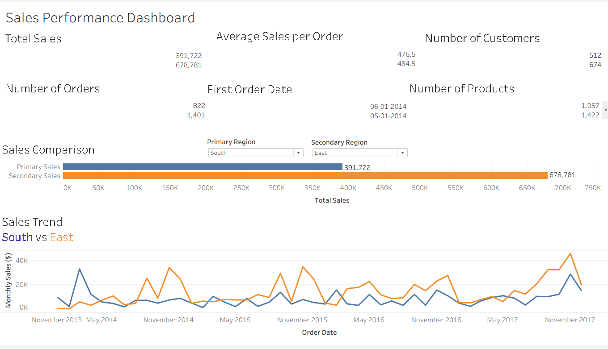
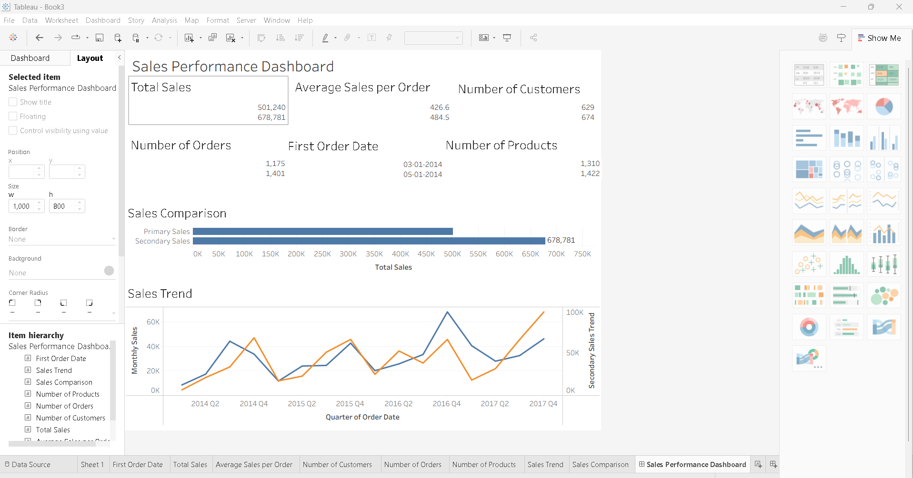
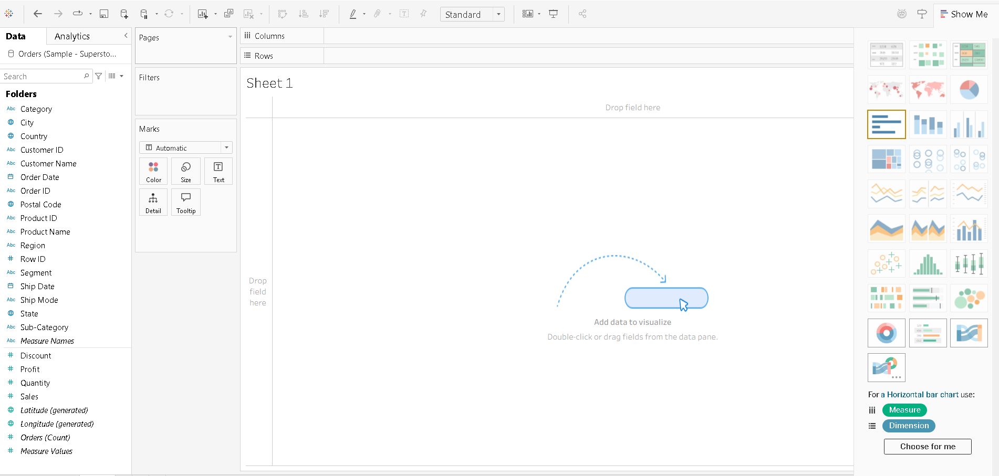
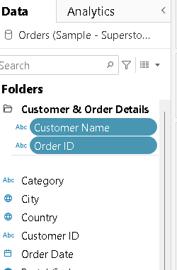
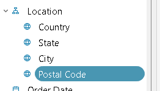
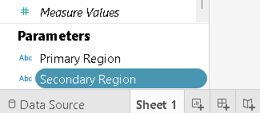
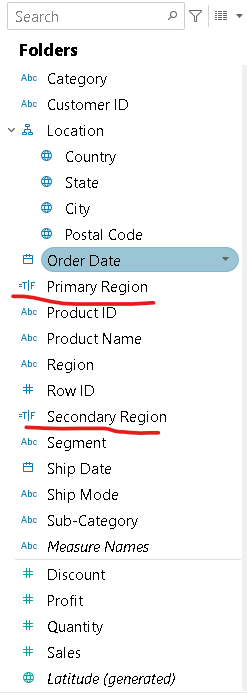
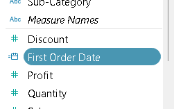

# Sales Performance Dashboard (Tableau)

An interactive Tableau dashboard that compares the sales performance of **two user-selected regions** side by side, built on the Sample Superstore dataset.

  

## Dashboard Preview



*Example view: South (primary) vs East (secondary). Pick any two regions with the parameter controls.*

**Live dashboard:** [View on Tableau Public](PASTE_YOUR_TABLEAU_PUBLIC_LINK_HERE)

---

## Table of Contents
- [Overview](#overview)
- [Objectives](#objectives)
- [Tech Stack](#tech-stack)
- [Key Metrics](#key-metrics)
- [How It Works](#how-it-works)
- [Dashboard Layout](#dashboard-layout)
- [Build Steps](#build-steps)
- [Repository Structure](#repository-structure)
- [How to Open the Workbook](#how-to-open-the-workbook)
- [What I Learned](#what-i-learned)
- [Author](#author)

---

## Overview

The dashboard lets a user pick a **Primary Region** and a **Secondary Region** from dropdowns and instantly compare them on sales, order volume, customers, products and monthly trend. Because the region choices are driven by parameters, the same dashboard works for every region pair without rebuilding any chart.

## Objectives

- Organise the Sample Superstore fields using folders and a geographic hierarchy.
- Create parameters and calculated fields for region-based comparison.
- Build worksheets for each KPI, a sales comparison chart and a monthly sales trend.
- Combine everything into a single, clean dashboard and publish it to Tableau Public.

## Tech Stack

| Tool | Purpose |
|------|---------|
| Tableau Desktop / Tableau Public | Building and publishing the dashboard |
| Sample Superstore dataset | Source data (orders, customers, products, regions) |
| Tableau calculated fields and parameters | Region-driven comparison logic |

## Key Metrics

The dashboard shows each of these for both regions:

| Metric | Definition |
|--------|------------|
| Total Sales | Sum of sales for the region |
| Average Sales per Order | Total sales divided by distinct orders |
| Number of Customers | Distinct customers |
| Number of Orders | Distinct orders |
| Number of Products | Distinct products sold |
| First Order Date | Earliest order date in the region |

Plus a **Sales Comparison** bar chart and a **Sales Trend** line chart (monthly sales for both regions).

## How It Works

1. Two string parameters, **Primary Region** and **Secondary Region**, each list Central, East, South and West.
2. Two Boolean calculated fields check whether a row's `[Region]` matches each parameter:
   ```
   [Region] = [Parameters].[Primary Region]
   [Region] = [Parameters].[Secondary Region]
   ```
3. Every measure wraps its calculation in `IF [Primary Region] THEN ... END` (or the Secondary equivalent), so it only counts rows from the selected region. Example:
   ```
   SUM( IF [Primary Region] THEN [Sales] END )
   / COUNTD( IF [Primary Region] THEN [Order ID] END )
   ```
4. Changing a parameter on the dashboard updates every sheet at once.

All formulas are listed in [tableau_formulas.md](tableau_formulas.md).

## Dashboard Layout

| Section | Content |
|---------|---------|
| Top | KPI tiles: Total Sales, Average Sales per Order, Number of Customers, Number of Orders, First Order Date, Number of Products |
| Middle | Sales Comparison bar chart with the Primary and Secondary Region selectors |
| Bottom | Sales Trend line chart of monthly sales for both regions |



## Build Steps

### 1. Connect to Sample Superstore and organise fields
Selected the Sample Superstore data and used **Group by > Folder** to keep related fields together.




### 2. Create the Location hierarchy
Grouped Country > State > City > Postal Code into one hierarchy.



### 3. Create the region parameters and calculated fields
Created the Primary Region and Secondary Region parameters, then the matching calculated fields.




### 4. Create First Order Date


### 5. Build the worksheets and the dashboard
Created one worksheet per KPI plus Sales Comparison and Sales Trend, then arranged them on a single dashboard with the parameter controls.

## Repository Structure

```
.
├── README.md
├── tableau_formulas.md
├── Sales_Performance_Dashboard.twb
└── images/
```

## How to Open the Workbook

1. Install [Tableau Desktop](https://www.tableau.com/products/desktop) or the free Tableau Public desktop app.
2. Make sure you have **Sample - Superstore.xls** (it ships with Tableau Desktop in the *My Tableau Repository > Datasources* folder).
3. Open `Sales_Performance_Dashboard.twb`. If Tableau cannot find the data, click **Edit Data Source** and point it to your copy of Sample - Superstore.
4. Open the **Sales Performance Dashboard** tab and use the two region dropdowns.

## What I Learned

- Using parameters with calculated fields to make one dashboard serve many comparisons.
- Conditional aggregation with `IF ... THEN ... END` inside `SUM` and `COUNTD`.
- Why `COUNTD` is needed to count distinct customers, orders and products.
- Organising a data source with folders and hierarchies.
- Laying out KPIs, comparison and trend views in one dashboard.

---

## Author

**Prakash**
[GitHub](https://github.com/itsprakashpoojary) | [LinkedIn](https://www.linkedin.com/in/itsprakashpoojary)
